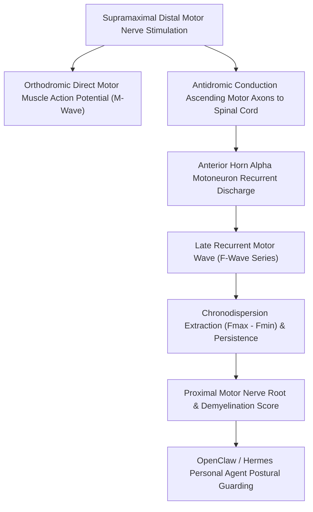

# Somatosensory F-Wave Chronodispersion Skill

[](LICENSE)
[](https://www.python.org/)
[](requirements.txt)
[](mcp_server.py)
[](SKILL.md)

Zero-dependency sovereign personal agent skill for non-invasive evaluation of Electroneuromyography (ENMG) F-wave chronodispersion (Fmax - Fmin in ms), persistence (%), and proximal motor nerve root conduction integrity.



## Features
- **Deterministic Math**: Pure Python standard library implementation with zero external dependencies.
- **Clinical Neurophysiology Standards**: Implements validated equations for minimal/maximal F-wave latencies, chronodispersion, and central conduction times.
- **Proximal Radiculopathy & Demyelination Screening**: Sensitive detection of proximal nerve root compression or polyneuropathic conduction dispersion.
- **Model Context Protocol (MCP)**: Native JSON-RPC tool integration for LLMs and autonomous agents.

## Quickstart

```python
from client import SomatosensoryFWaveChronodispersionClient

client = SomatosensoryFWaveChronodispersionClient()
result = client.evaluate_f_wave(
    f_min_latency_ms=26.4,
    f_max_latency_ms=29.8,
    f_persistence_pct=90.0
)
print("Chronodispersion:", result["f_chronodispersion_ms"], "ms")
print("Proximal Motor Score:", result["proximal_motor_score"])
print("Classification:", result["classification"])
```

## License
Apache-2.0
